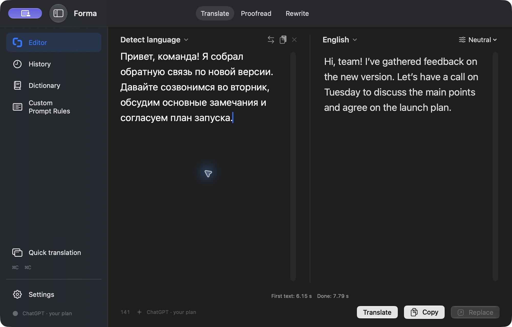
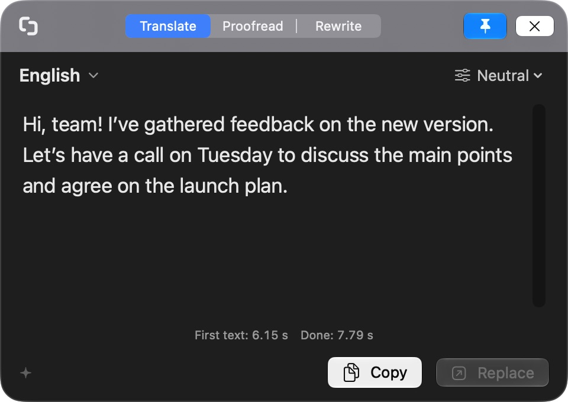
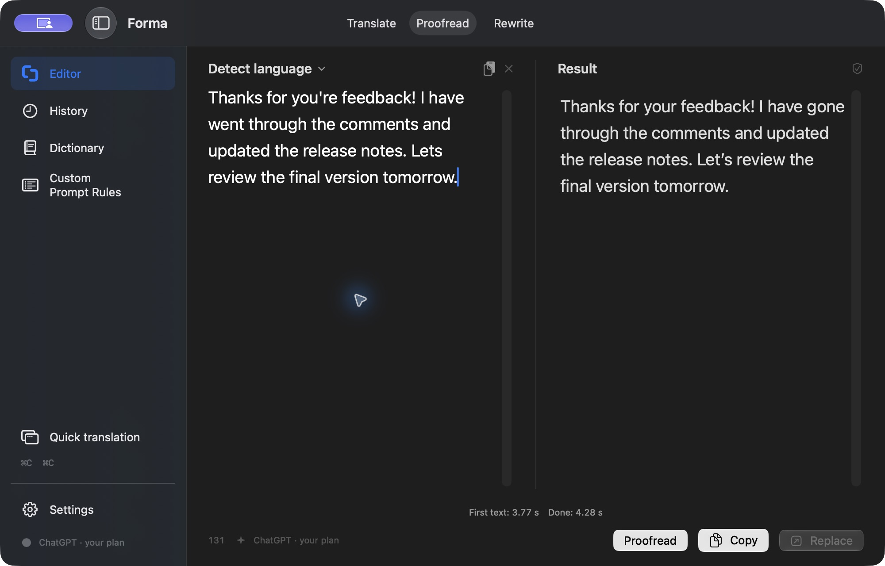
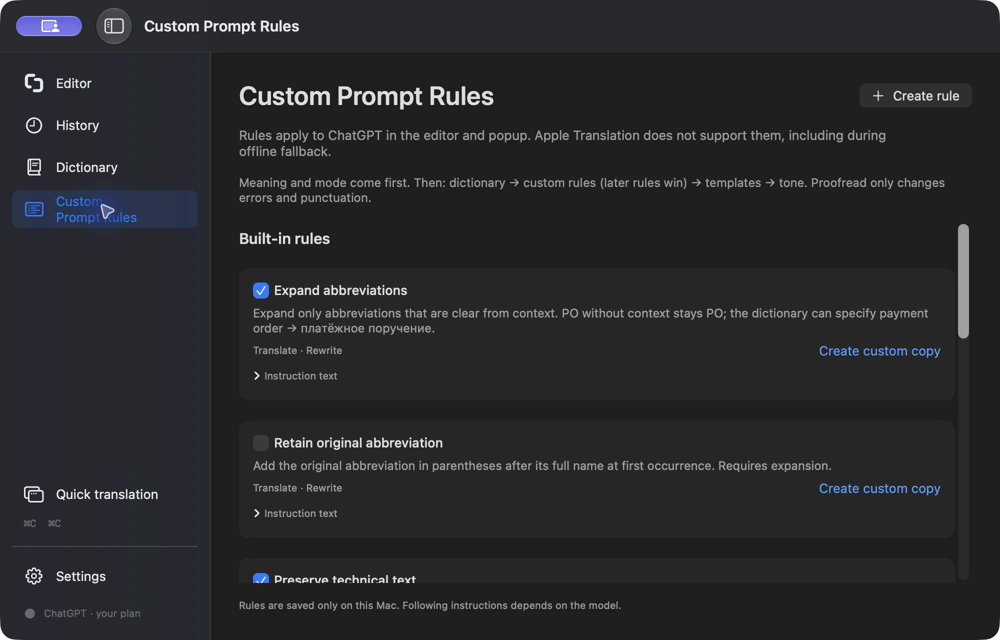

<p align="center">
  
</p>

# Forma

**Translate, proofread, and rewrite without leaving your workflow.**

Forma is a native macOS writing assistant built with SwiftUI and AppKit. Select text in another app, press **⌘C twice**, and work with the result in a small floating popup. Or open the full editor for a side-by-side view.

Connect your ChatGPT account to use its eligible plan usage. No API key, extra Forma subscription, or separately installed CLI is required.

**Apple Silicon · macOS 26+ · English and Russian interface · MIT license**

[Download the latest release](https://github.com/liquorice-head/forma-app/releases/latest) · [Report an issue](https://github.com/liquorice-head/forma-app/issues) · [License](LICENSE)



## Why I built it

I work in a multilingual environment and used DeepL for years, especially its macOS shortcut. I wanted a more predictable daily workflow, fewer interruptions from character limits, and more control over how my text sounds. Since I already had a ChatGPT subscription, I built a dedicated app around it.

You can ask a chatbot to translate or edit text. Forma makes that a repeatable keyboard action, with your preferences already in place.

## What it does

| Feature | How it helps |
| --- | --- |
| **Translate** | Detect the source language or choose it yourself, then select a target language from a searchable list. |
| **Proofread** | Fix spelling, grammar, and punctuation while preserving your wording and meaning. |
| **Rewrite** | Rephrase text with neutral, friendly, business, or formal tone. |
| **Quick popup** | Invoke it with double ⌘C or a custom shortcut. Move it, pin it, copy the result, or replace the captured selection. |
| **Contextual alternatives** | Click a result word or select a phrase to explore alternatives in context. |
| **Personal dictionary** | Save preferred translations and terminology. |
| **Custom Prompt Rules** | Save reusable instructions, choose which modes they apply to, and toggle each rule independently. |
| **History** | Revisit previous results in the app. |
| **Optional iCloud sync** | Sync dictionary entries, the latest 500 history results, custom rules, and template switches across your Macs. |
| **Apple Translation** | Translate supported language pairs on the Mac, including offline after the required languages are downloaded. |

The editor can process after a short pause in typing and immediately after paste, or wait for a manual action. Other settings include model and supported reasoning controls, optional repeated-request caching, processing times, launch at login, and menu bar visibility. Forma follows the system's light or dark appearance.

### A shortcut away

1. Select text in the app you're working in.
2. Press **⌘C twice** in quick succession, or use your configured shortcut.
3. Choose Translate, Proofread, or Rewrite in the popup.
4. **Copy** the result or **Replace** the original selection.

Replacement depends on the source app's support for Accessibility and paste. If insertion cannot be confirmed, Forma leaves the result on the clipboard so you can paste it yourself.



### Proofread without starting a conversation

Keep the text, fix the mistakes. Switch to Rewrite when you want broader changes.



### Your terminology and rules

Use the dictionary for preferred terms and Custom Prompt Rules for reusable writing instructions. Seven optional built-in templates cover abbreviation expansion, retaining original abbreviations, technical text, American or British English, typography, and plain language for Rewrite.

Rules apply to ChatGPT processing in the editor, popup, and contextual alternatives. Apple Translation does not support prompt rules, proofreading, rewriting, or contextual alternatives. Following a rule depends on the model; review important output.



## Install and get started

1. Download the **Apple Silicon DMG** from [Releases](https://github.com/liquorice-head/forma-app/releases/latest).
2. Open it and drag **Forma** to **Applications**. Distribution builds are Developer ID signed and notarized by Apple.
3. Launch Forma and connect ChatGPT in **Settings**. Allow it to use your eligible ChatGPT plan when prompted.
4. For the global shortcut and Replace, enable Forma in **System Settings → Privacy & Security → Accessibility**. Use **Save and Reopen** if Forma asks you to restart.
5. Select some text and press **⌘C twice**.

You can also use the editor with Apple Translation for supported language pairs without connecting ChatGPT. Allow macOS to download any required language resources first.

### ChatGPT access and limits

Forma uses **Sign in with ChatGPT** and asks for permission to use your plan for eligible AI requests. Availability depends on your account, workspace, region, and OpenAI's current policies. Having a ChatGPT account alone does not guarantee access.

Requests count toward your existing plan usage; connecting Forma does not add a separate allowance. You can manage app access and usage limits in ChatGPT Settings. See OpenAI's [Sign in with ChatGPT guide](https://learn.chatgpt.com/docs/sign-in-with-chatgpt) for current details.

API-key connections, other AI providers, and local models are planned; they are not available yet.

## Privacy and storage

- **ChatGPT mode:** input text and relevant instructions, including applicable dictionary entries and rules, are sent directly to OpenAI for processing. Forma requests `store: false`; OpenAI's own data policies still apply. Sign-in does not give Forma access to your ChatGPT conversation history.
- **Apple mode:** translation runs on your Mac using Apple's Translation framework. Downloading language resources may require a connection.
- **Credentials:** ChatGPT tokens are stored in the local macOS Keychain and are not included in iCloud sync.
- **Local data:** history, dictionary entries, and custom rules are stored in `~/Library/Application Support/Forma/`. macOS also stores app preferences locally.
- **Optional iCloud:** sync is off until explicitly enabled in **Settings → Sync**. It includes source text in the latest 500 history results, as well as dictionary entries, rules, and template switches, in your private iCloud database. Disabling sync retains local and cloud copies. Changing iCloud accounts disables sync until you enable it again.
- **Selection capture:** Forma reads the selected text when you invoke its shortcut. It does not poll clipboard contents in the background.
- **Updates:** the built-in Sparkle updater contacts GitHub for releases and verifies signed update feeds and archives. Public releases do not require a GitHub token.

## Current scope and plans

The core text workflow is ready to try. Forma is still early software, and feedback on different apps, languages, and keyboard workflows is welcome.

Planned directions:

- Work directly with documents.
- Add other AI services, including connections through your own API keys.
- Support local models.

These are plans, with no committed release dates. Intel Macs, iOS, Windows, and Linux are not currently supported. iCloud sync has been checked with two isolated clients on one Mac; installation and sync on two physical Macs and migration from older development builds still need broader validation.

## Build from source

Requires an Apple Silicon Mac, **macOS 26+**, and **Xcode 26+** with its command-line tools selected. Swift Package Manager resolves the pinned Sparkle dependency.

```sh
git clone https://github.com/liquorice-head/forma-app.git
cd forma-app
swift test --disable-sandbox
```

For a local app bundle, use a stable signing identity to preserve Keychain and Accessibility approvals across rebuilds:

```sh
security find-identity -v -p codesigning
FORMA_SIGN_IDENTITY="YOUR_CERTIFICATE_FINGERPRINT" zsh scripts/build-app.sh release
open dist/Forma.app
```

A disposable build can explicitly use ad-hoc signing:

```sh
FORMA_ALLOW_ADHOC=1 zsh scripts/build-app.sh debug
```

Ad-hoc builds are for local development and can lose system approvals between rebuilds. They are not notarized distribution builds.

`Forma.xcodeproj` is included for Xcode development. A build without a matching CloudKit provisioning profile keeps iCloud sync unavailable; translation and local storage still work. Forks need their own signing identities, bundle identifiers, CloudKit containers, update signing keys, and release repository configuration. See [RELEASING.md](RELEASING.md).

## Feedback and contributions

Open an [issue](https://github.com/liquorice-head/forma-app/issues) with your macOS and Forma versions, processing engine, steps to reproduce, and expected behavior. Use sample text and remove account details from screenshots and logs. Small, focused pull requests are welcome; please discuss larger changes in an issue first and run the tests before submitting.

## License and acknowledgments

Forma is available under the [MIT license](LICENSE). The app includes [Sparkle](https://sparkle-project.org/), distributed under its own license, bundled with the application.

Forma is an independent project and is not affiliated with DeepL, OpenAI, or Apple.
